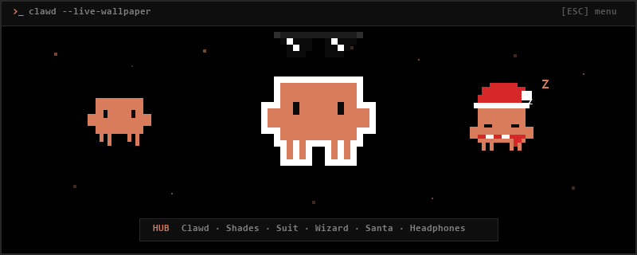

# `>_` clawd

**Clawd** — the **Claude Code** terminal pet — doing absolutely nothing productive on your desktop.  
Single file (`index.html`), zero dependencies — ready for **Lively Wallpaper**, **Wallpaper Engine**, or any web browser.

<p align="center">
  
</p>

---

## `>_` features

```txt
size          2x .. 12x  (Tiny 3x · Medium 7x · Giant 11x)
styles        Clawd · Sunglasses · Suit · Wizard · Gentleman · Santa · Headphones
modes         Center · Wander · Follow · DVD
backgrounds   Pure Black (OLED) · Stars · Terminal
extras        Sticker white border · Auto-sleep mode (zZz) · Cursor eye-tracking
```

---

## `>_` install

Download the repository (**Code → Download ZIP**) or clone it:

```bash
git clone https://github.com/polfiliberto/clawd.git
```

Keep the folder in a permanent location on your computer and load **`index.html`** into your wallpaper app:

### Lively Wallpaper (Windows · Free & Open Source)
1. Open [Lively Wallpaper](https://www.rocksdanister.com/lively/).
2. Click **`+` Add Wallpaper** and drag `index.html` into the window.

### Wallpaper Engine (Windows · Steam)
1. Click **Open Wallpaper → Open from file** at the bottom left.
2. Select `index.html`.

### Browser / macOS / Linux
- Open `index.html` directly in any browser, or use web-wallpaper apps like [Plash](https://sindresorhus.com/plash) (macOS) or *HTML Wallpaper* (KDE).

---

## `>_` controls

| Input | Action |
| :--- | :--- |
| `[ESC]` | Open / close the settings terminal (`>_ clawd --settings`) |
| `Click on Clawd` | Jump with pixel particles |
| `Click on background` | Walk to that spot *(in Wander mode)* |
| `Mouse idle` | Clawd falls asleep (`zZz`) and wakes up when you move the mouse |

> **Note for Lively Wallpaper:** if your desktop doesn't forward the `[ESC]` key to the wallpaper, open `index.html` in your browser to preview your preferred setup and edit the `DEFAULTS` block at the top of `<script>`.

---

## `>_` config

You can customize the default startup settings by editing `DEFAULTS` inside `index.html`:

```js
const DEFAULTS = {
    pixelSize: 4,            // 2..12 (3 Tiny, 7 Medium, 11 Giant)
    outfit: 'sunglasses',    // 'classic', 'sunglasses', 'suit', 'wizard', 'gentleman', 'santa', 'headphones'
    mode: 'center',          // 'center', 'wander', 'follow', 'dvd'
    bgEffect: 'pure',        // 'pure', 'stars', 'matrix'
    stickerBorder: false
};
```

---

## `>_` disclaimer

Non-commercial fan-made project. **Clawd** is the official terminal mascot of **Claude Code** by Anthropic. This project is not affiliated with or endorsed by Anthropic.
